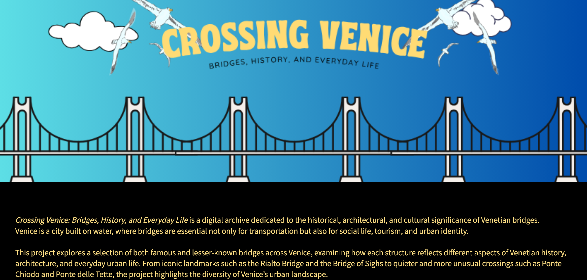

# Crossing Venice – Digital Cultural Heritage Project

## Overview

This personal project explores the digital documentation and presentation of cultural heritage through the Omeka platform.

The work focuses on the Constitution Bridge (Ponte della Costituzione) in Venice, creating a structured digital item with descriptive information and metadata.

## Project Details

- **Platform:** Omeka
- **Field:** Digital and Public Humanities
- **Topic:** Venetian architectural and cultural heritage
- **Metadata:** Dublin Core

## Skills and Methods

- Digital collection management
- Metadata creation and organization
- Digital cultural heritage documentation
- Content description and cataloguing
- Omeka platform management

## Online Project

[View the original Omeka item](https://www.vedphlab.it/textualheritage/giulia/items/show/2)

## Academic Context

Developed as part of my Master's studies in Digital and Public Humanities, for Textual Heritage and Digital Preservation.
