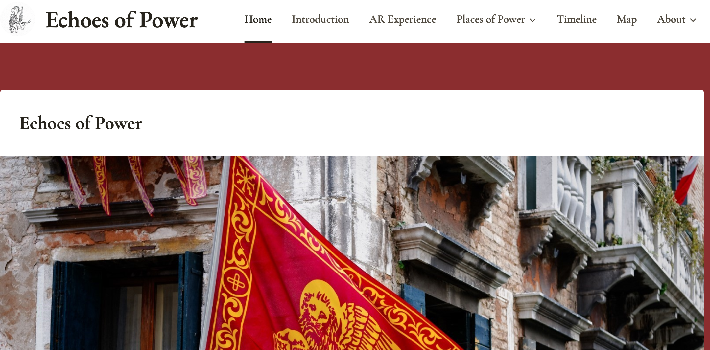

# Echoes of Power – Digital Humanities Group Project

## Overview

This collaborative project focuses on the application of Digital Humanities methodologies to build an interactive digital workspace and cultural platform.

The work was developed as a joint effort by a team of 3 members, structuring digital resources and creating an accessible online environment for research and public engagement.

## Project Details

- **Platform:** WordPress / Altervista / Blippar (disconneted)
- **Field:** Digital and Public Humanities
- **Topic:** Digital resources and cultural heritage management
- **Collaboration:** Group Project (3 contributors)

## Skills and Methods

- Collaborative web platform design
- Digital content curation and management
- Digital Humanities workflow integration
- Information architecture and web layout
- Group project management and teamwork

## Online Project

- [View the live MoLab DH platform](https://molabdh.altervista.org/)

## Academic Context

Developed as part of my Master's Degree in Digital and Public Humanities.
